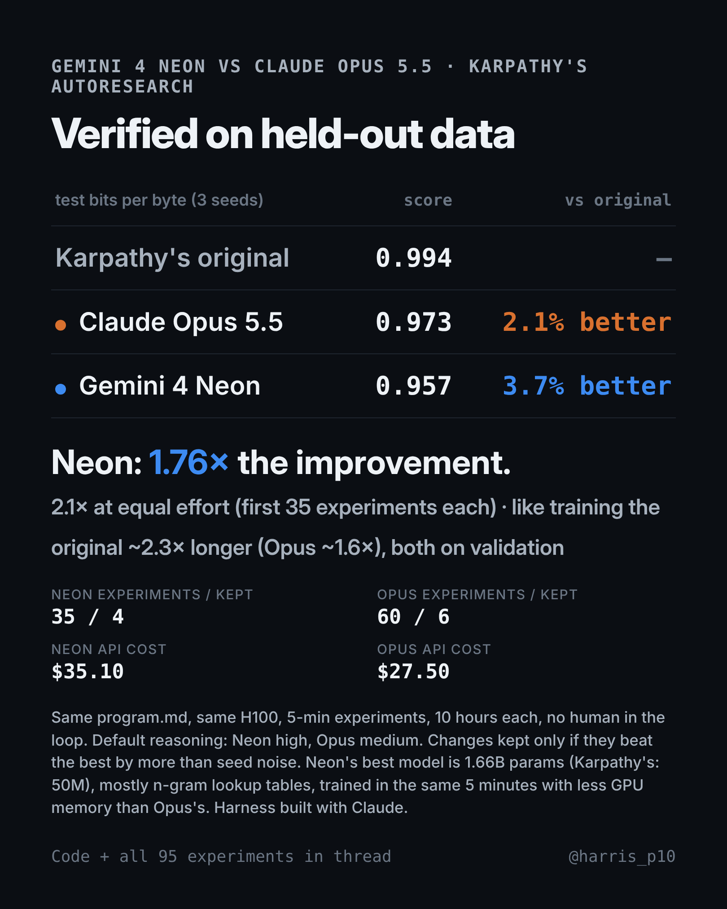
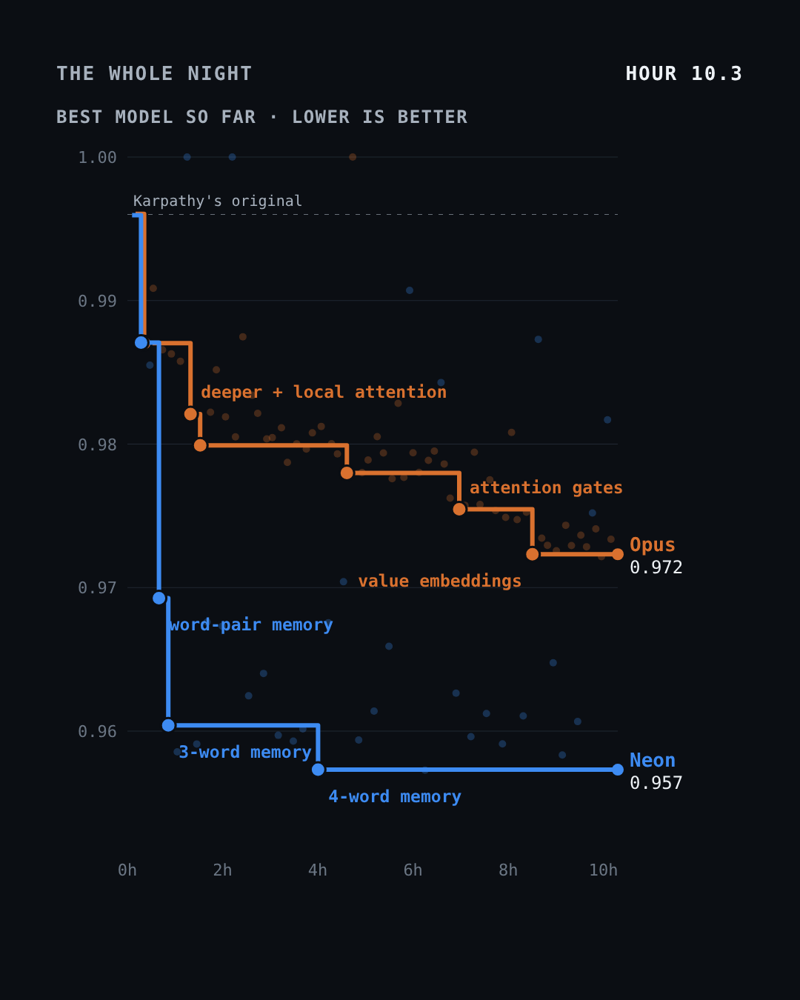
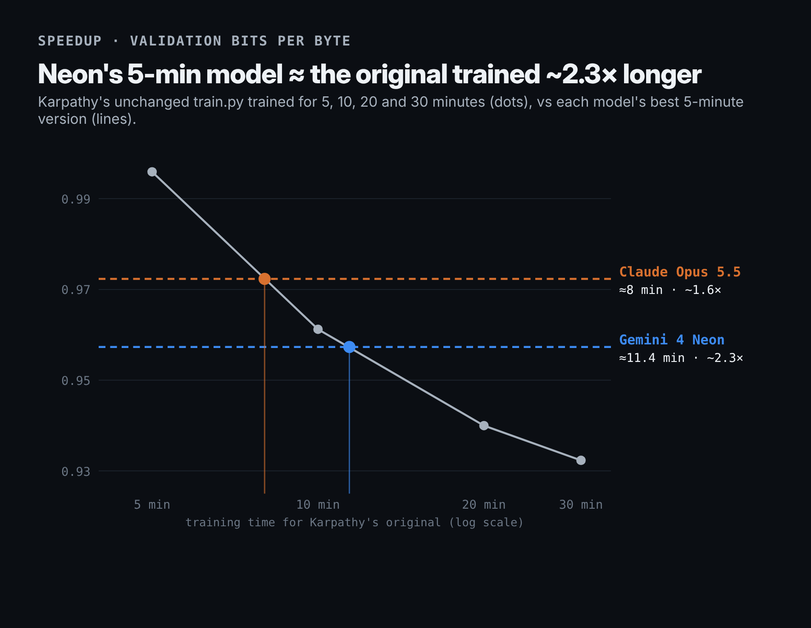
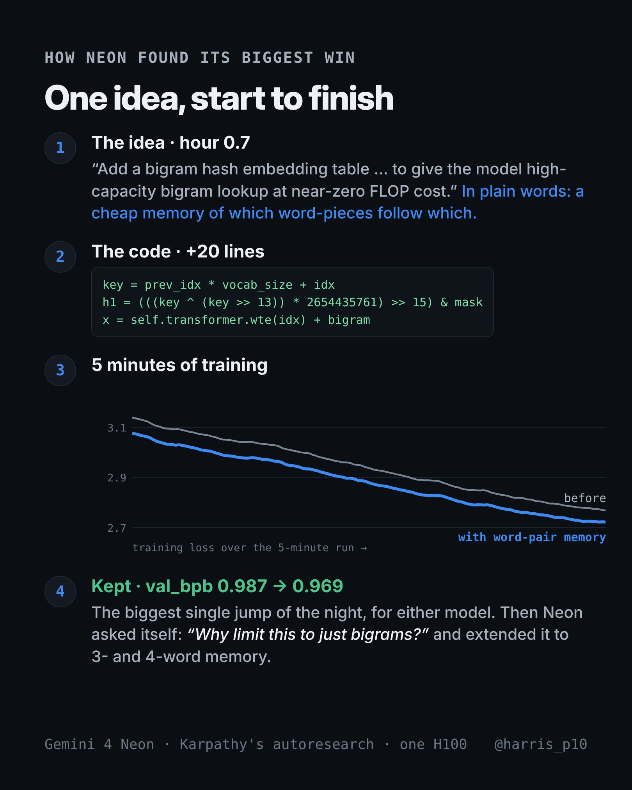

# Gemini 4 Neon vs Claude Opus 5.5 on Karpathy's autoresearch

**Can a frontier model do ML research on its own, overnight?** I gave Gemini 4 Neon and Claude Opus 5.5 the same task: improve [Karpathy's autoresearch](https://github.com/karpathy/autoresearch) GPT, one experiment at a time, on one NVIDIA H100, for 10 hours each, with no human in the loop. Every change was kept only if it beat the model's best so far by more than run-to-run noise. In the morning, each model's best version was retrained from scratch and scored on held-out data neither model ever saw.

▶ **[Watch the 33-second video](media/neon_overnight.mp4)**



## Results

**Held-out test** (each best `train.py` retrained from scratch, 3 seeds, scored on a data shard never visible during the night):

| | Test bits per byte (lower = better) | vs Karpathy's original |
|---|---:|---:|
| Karpathy's original `train.py` | 0.9940 ± 0.0011 | — |
| Claude Opus 5.5 | 0.9732 ± 0.0022 | 2.1% better |
| **Gemini 4 Neon** | **0.9573 ± 0.0009** | **3.7% better** |

- **Neon improved the model 1.76× as much as Opus.** Both improvements are larger than 2× the seed-to-seed noise.
- **Neon's gains held up exactly on unseen data** (best validation 0.9573, test 0.9573). Opus's slipped slightly (0.9723 → 0.9732).
- **At equal effort, the gap is wider:** after 35 experiments each, Neon's validation improvement was ~2.1× Opus's.
- **In training-time terms:** Neon's 5-minute model matches Karpathy's original trained for ~11.4 minutes (**~2.3× speedup**); Opus's matches ~8 minutes (**~1.6×**). Estimated by training the unchanged original for 10, 20 and 30 minutes and interpolating on validation bits per byte (single seed per length).




| | Gemini 4 Neon | Claude Opus 5.5 |
|---|---:|---:|
| Experiments in 10 hours | 35 | 60 |
| Kept (beat best by > noise) | 4 | 6 |
| API cost | $35.07 | $27.46 |
| Median time per idea (model call) | ~8 min | ~1.5 min |
| Reasoning setting | default (`thinking_level=high`) | default (`effort=medium`) |
| Best model size | 1.66B params (mostly n-gram lookup tables) | 94M params |
| Best model peak GPU memory | 56 GB | 69 GB |

## How Neon found its biggest win



At hour 0.7, Neon proposed a **bigram hash embedding**: a cheap lookup table indexed by a hash of each (previous token, current token) pair, added to the token embeddings. It's about 20 lines of code and costs almost no compute. It was the largest single improvement of the night for either model (−0.018 val_bpb). In its next turn, Neon's reasoning summary says:

> "That Experiment 3 result was fantastic … Now, my mind is racing, as I need to figure out why it worked and what we can push further. … why limit this to just bigrams?"

It then extended the idea to trigrams (kept), and later to a fused 4-order input+output n-gram memory (kept).

## Two research styles

**Neon took big, expensive swings.** Most of its 35 experiments were architectural: n-gram memories up to 4.3B parameters, a DeepSeek-style mixture of experts (0.12 bpb worse), product-key memory layers, custom fused cross-entropy kernels, document-masked attention. Four were kept, and the n-gram line of work produced nearly all of its gain. Late in the night its `train.py` grew to ~830 lines, and 6 responses were cut off mid-file and needed a repair turn.

**Opus ran a careful, systematic search.** Its 60 experiments were mostly sweeps (depth vs width, learning rates, warmdown, attention window patterns) plus ideas from the modded-nanogpt speedrun (attention output gates, value-embedding placement, Muon momentum warmdown). It repeatedly used a smart tactic: **combine two near-misses** that each fell just short of the noise threshold. Three of its six keeps came that way.

### Every kept change: Gemini 4 Neon

| Exp | Hour | val_bpb | Δ vs previous best | Hypothesis (model's own words, trimmed) |
|---:|---:|---:|---:|---|
| 0 | 0.1 | 0.9959 | +0.0000 | baseline (Karpathy's train.py) |
| 1 | 0.3 | 0.9871 | -0.0089 | Halve TOTAL_BATCH_SIZE from 2**19 (524K) to 2**18 (262K) with ~0.75x scaled LRs so the 50M model takes 2x as many optimizer steps in the 5-minute budget, moving closer to the critical batch size. |
| 3 | 0.7 | 0.9693 | -0.0178 | Add a 2-head bigram hash embedding table (2 x 131072 x n_embd/2, BOS-masked) summed into token embeddings before RMSNorm to give the 8K-vocab model high-capacity bigram lookup at near-zero FLOP cost. |
| 4 | 0.9 | 0.9604 | -0.0089 | Scale bigram hash tables 4x to 524,288 buckets per head and add 2-head BOS-masked trigram hash embeddings (2 x 524,288 x n_embd/2) summed into token embeddings to reduce bigram hash collisions and give the 8K-vocab model high-capa… |
| 16 | 4.0 | 0.9573 | -0.0031 | Upgrade n-gram memory to a hardware-fused 4-order Input+Output architecture (bigram, trigram, 1M-bucket 4-gram, skip-bigram) packing input and output vectors into the same embedding rows (halving random gathers/scatters) with exac… |
### Every kept change: Claude Opus 5.5

| Exp | Hour | val_bpb | Δ vs previous best | Hypothesis (model's own words, trimmed) |
|---:|---:|---:|---:|---|
| 0 | 0.2 | 0.9960 | +0.0000 | baseline (Karpathy's train.py) |
| 1 | 0.4 | 0.9870 | -0.0090 | Halve TOTAL_BATCH_SIZE to 2**18 (no grad accumulation): the ~50M model in a 5-min budget is likely step-limited, so twice as many optimizer steps at half the batch should lower val_bpb. |
| 6 | 1.3 | 0.9821 | -0.0049 | Combine DEPTH=10 with WARMDOWN_RATIO=0.7 (together -0.0013, a near-miss), and shrink the short sliding window from 1024 to 512 tokens. Attention is about a third of the FLOPs at 640 dim and 2048 context, so quarter-context windows… |
| 7 | 1.5 | 0.9799 | -0.0022 | Cut attention cost further: switch WINDOW_PATTERN to "SSSSL" (long-context layers at 4 and 9 only) and shrink the short window from 512 to 256 tokens. The last experiment showed this run is throughput-limited, and two full-context… |
| 25 | 4.6 | 0.9780 | -0.0019 | Combine the two best near-misses, which are independent: DEPTH=8 at 768 dim (exp 18, -0.0012) and "SSSL" with a 128-token short window (exp 24, -0.0006). The first gives wider matmuls with higher MFU and fewer layers. The second g… |
| 40 | 7.0 | 0.9755 | -0.0025 | Combine the two best near-misses. The first is the per-head attention output gate, y_h *= 2·sigmoid(W·x[:, :32]) with W initialised to zero, which scored -0.0017 in exp 39. The second is EMBEDDING_LR 0.9, which scored -0.0004 in e… |
| 50 | 8.5 | 0.9723 | -0.0031 | Move the value embeddings from alternating layers (1,3,5,7) to the first and last two layers (0,1,6,7), the placement used in modded-nanogpt, where token identity matters most. Pair this with the Muon momentum warmdown (0.95 to 0.… |
All experiments (including discarded ones), with each model's full response, the `train.py` it wrote, and the training log, are in `results/<model>/exps/`. `results/<model>/log.tsv` has one row per experiment.

## Setup

- **Task:** Karpathy's autoresearch, unchanged: a ~50M-parameter GPT (`train.py`) trained for a fixed 5 minutes on one H100, scored by validation bits per byte on his ClimbMix data. The models may change anything in `train.py`.
- **Loop:** one model call per experiment. Each turn the model gets the instructions (Karpathy's `program.md` research rules, verbatim), `prepare.py`, the baseline, its current best `train.py`, the full history of its experiments, and the last run's log. It returns a one-line hypothesis and a complete new `train.py`. The harness runs it, scores it, and keeps or discards it. Crashes get up to 2 repair turns.
- **Keep rule:** kept only if val_bpb beats the model's best by more than the noise floor (0.0019 = 1 std of the baseline across 5 seeds). Karpathy's version keeps any improvement; this one is stricter so luck doesn't count as progress.
- **Fairness:** same instructions, same H100 (both models shared one GPU and took turns, so neither got a faster card), same 10-hour budget, $40 cap each, each model at its provider's default reasoning setting. Neither model saw the other's experiments.
- **Guards:** the held-out test shard doesn't exist inside the sandbox during the night. The sandbox has no network and no API keys. `prepare.py` (Karpathy's data and scoring code) is hash-checked, and the score is read from its `evaluate_bpb`, never from what `train.py` prints. Every `train.py` is statically checked before running: no reading data files, no training on the validation split, no environment variables, no patching `prepare`, exactly one call to `evaluate_bpb`. Pre-flight tests prove the sandbox and guard work (`results/preflight/`).

## Design decisions (and why)

- **A harness instead of a coding agent.** Karpathy runs an agent in a terminal. Here each model gets an identical, fixed context each turn and returns a file. That isolates research judgment from agent tooling (file browsing, shell use), makes the two models directly comparable, and lets the harness, not the model, own timing, scoring and keep/discard.
- **A noise-floor keep rule.** With ~100 tries, a "keep anything better" rule accepts lucky noise. Measuring seed variance first and requiring a margin above it means every kept change is likely real. The cost: small real gains get discarded (both models had several near-misses).
- **A held-out test shard, touched once.** Selecting the best of ~50 experiments on validation data overfits to it. Retraining each winner from scratch and scoring on unseen data checks for that. Neon's validation and test scores matched exactly; Opus's dropped by 0.001.
- **Measuring speedup, not just bits per byte.** 0.957 vs 0.973 means nothing to most people. Training the original for longer and finding where it matches each model gives an intuitive "Nx more efficient" number.
- **Verifying the hardware.** The first plan used two separate H100 boxes. Pre-flight showed one ran at half the throughput of the other (267M vs 494M tokens in 5 minutes, same card model), which would have decided the result on its own. That box was replaced by running both models on the verified box, taking turns.

## Limitations

- **One run per model, one task.** It shows how this night went, not a general ranking.
- **Default settings differ:** Neon's default reasoning is high, Opus's is medium. That's how each ships, but Opus at high effort might do better (a natural follow-up).
- **Neon's model got much bigger in parameters** (1.66B, mostly sparse lookup tables), within the rules and the same 5-minute budget, using less GPU memory than Opus's version. Whether that's "the same model, improved" is a fair debate.
- **Speedup numbers are estimates:** one seed per training length, interpolated, on validation data.
- **Prompt caching rarely applied:** calls were ~10 minutes apart and the provider caches expire after ~5, so both costs are close to uncached prices.
- **Harness built with Claude**, which is also the comparison model. The instructions are Karpathy's, identical for both, and every prompt, response and file is published here.

## Reproduce

Needs one H100 80GB (or two), a paid Gemini API key and an Anthropic API key. About 12 hours, ~$60 in GPU time and ~$65 in API calls.

```bash
curl -LsSf https://astral.sh/uv/install.sh | sh && source ~/.local/bin/env
uv sync
uv run python -m orchestrator.data_setup     # data, tokenizer, held-out test shard, offline attention kernel
uv run python -m orchestrator.preflight      # sandbox + guard + timeout checks, 5-seed noise floor
echo 'export GEMINI_API_KEY=...' > ~/.ai_keys && echo 'export ANTHROPIC_API_KEY=...' >> ~/.ai_keys
./scripts/start.sh neon && ./scripts/start.sh opus   # 10 hours, both share the GPU
./scripts/morning.sh                                 # held-out test, dashboard, replay video
```

Offline smoke test with a CPU stand-in and a mock model: `export AUTORESEARCH_SMOKE=1 AUTORESEARCH_SMOKE_BUDGET=8`, then `python -m orchestrator.data_setup --smoke`, `python -m orchestrator.preflight --seeds 3`, `python -m orchestrator.run_arm --arm test --provider mock --max-exps 8`.

## Repo layout

| Path | What |
|---|---|
| `train.py`, `prepare.py`, `program_karpathy_original.md` | Karpathy's autoresearch. `prepare.py` has 3 marked patches (configurable data path, held-out test shard, score written to a file). |
| `program.md` | The instructions both models got (Karpathy's research rules + the reply format). |
| `orchestrator/` | The loop, model adapters, sandbox, static guard, pre-flight, final test. |
| `analysis/` | Dashboard and replay video. |
| `scripts/` | One-command phases: setup, dry run, start, morning. |
| `results/` | Everything from the run: every experiment, held-out test, pre-flight, speedup logs. Open `results/dashboard.html` for the interactive replay. |
| `media/` | Video, charts, stills. |

## License

MIT. `train.py`, `prepare.py` and `program_karpathy_original.md` are from [karpathy/autoresearch](https://github.com/karpathy/autoresearch) (MIT, © Andrej Karpathy).
